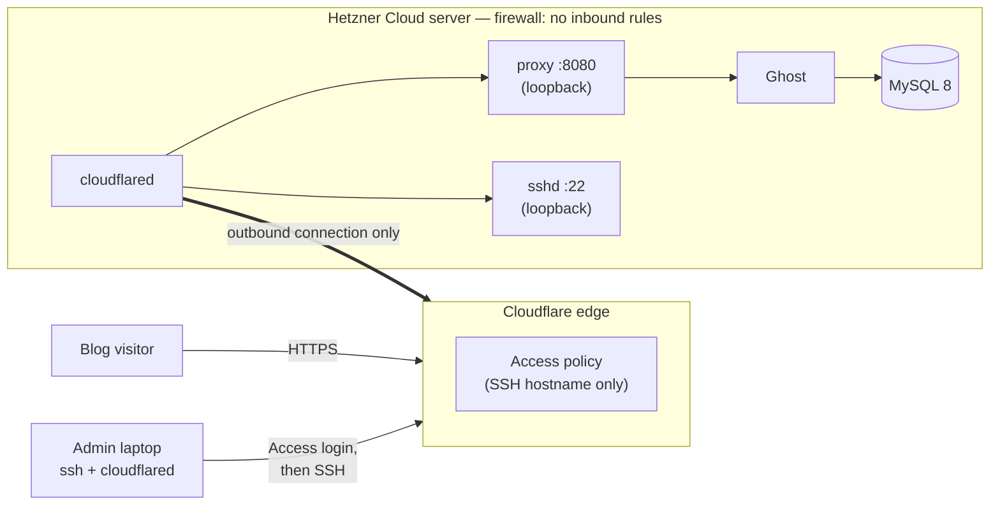

# One-command Ghost on Hetzner, reachable only through a tunnel

`./deploy.sh` creates a Hetzner Cloud server running [Ghost](https://ghost.org)
and publishes it through a Cloudflare Tunnel. The server has **no inbound
ports open at all**: not 22, not 80, not 443. The blog and SSH are reachable
only through the tunnel, and SSH additionally sits behind a Cloudflare Access
login.



## Quick start

You need `bash`, `curl` and `jq` on your machine (macOS or Linux). Nothing else
is installed locally and nothing is installed over SSH.

```bash
cp .env.example .env    # fill in the four required values
./deploy.sh
```

After a few minutes the script prints the blog URL. Open
`https://<your blog>/ghost/` straight away and create the owner account;
until you do, anyone who finds the URL could.

To remove everything again:

```bash
./destroy.sh
```

### What you need to provide

| Value in `.env` | Where it comes from |
|---|---|
| `HCLOUD_TOKEN` | Hetzner Console → your project → Security → API tokens → Read & Write |
| `CLOUDFLARE_API_TOKEN` | Cloudflare dashboard → My Profile → API Tokens → Create Custom Token, with the permissions below |
| `BLOG_HOSTNAME` | The address for the blog, e.g. `blog.example.com`. The domain must already be a zone in your Cloudflare account |
| `ACCESS_EMAIL` | The one email address allowed to open the SSH tunnel |

Cloudflare API token permissions:

| Scope | Permission | Used for |
|---|---|---|
| Account | Cloudflare Tunnel: Edit | create and configure the tunnel |
| Account | Access: Apps and Policies: Edit | protect the SSH hostname |
| Zone | DNS: Edit | point the hostnames at the tunnel |
| Zone | Zone: Read | look up the zone and account |

One-time Cloudflare setup: Zero Trust must be enabled on the account (free
plan is enough; the dashboard asks you to pick a team name the first time you
open Zero Trust). The Access step fails with Cloudflare's own message if it is not.

Optional settings (server size, location, names, image versions) are listed
with their defaults in [.env.example](./.env.example).

## What the script does

1. **Checks** both API tokens, the Cloudflare zone and the server type before creating anything.
2. **Cloudflare:** creates a tunnel, routes `BLOG_HOSTNAME` to the blog and an
   SSH hostname to sshd, creates the two DNS records, and puts the SSH
   hostname behind an Access policy that allows only `ACCESS_EMAIL`.
3. **Hetzner:** creates a dedicated SSH key (if you have none for this
   project), a firewall with no inbound rules, and the server. The firewall
   is attached in the same API call that creates the server, so port 22 is
   never exposed, not even during first boot.
4. **First boot** ([server/cloud-init.yaml.tpl](./server/cloud-init.yaml.tpl)):
   the server installs Docker, locks sshd to loopback, generates its own
   database passwords and starts the stack in
   [server/docker-compose.yml](./server/docker-compose.yml). `cloudflared`
   then connects out to Cloudflare.
5. **Waits** until the blog answers over HTTPS and prints how to connect.

Running `./deploy.sh` again is safe: every resource is looked up by name and
reused. An existing server is left untouched.

## SSH access

```bash
ssh -F ssh_config <ssh hostname printed by deploy.sh>
```

This needs [`cloudflared`](https://developers.cloudflare.com/cloudflare-one/networks/connectors/cloudflare-tunnel/downloads/)
on your machine. A browser window opens for the Cloudflare Access login, then
SSH continues with the key the script created. `deploy.sh` writes `ssh_config`
for you (git-ignored).

There are three independent locks on SSH: the tunnel is the only network path,
Cloudflare Access admits one email address, and sshd accepts only the project
key for one non-root user.

## Security choices

| Choice | Why |
|---|---|
| Hetzner firewall with zero inbound rules, attached at creation | The requirement. Hetzner drops all inbound traffic for such a firewall and still allows outbound, which is all a tunnel needs |
| `ufw` deny-incoming on the host as well | A second layer if the cloud firewall is ever detached by mistake |
| sshd listens on `127.0.0.1` only | Even with both firewalls gone, SSH is not on the public interface |
| Ghost and the proxy bind to loopback / the Docker network only | Same reasoning for HTTP |
| Database passwords generated on the server | They never exist on the deploying machine or in any API call |
| An SSH key is always uploaded | Without one, Hetzner sets a root password and emails it |
| Root login disabled; one sudo user, key only | Standard hardening |
| Automatic security updates | The server is never patched by hand |

The small `proxy` container exists for one reason: Cloudflare terminates
HTTPS and the tunnel hands Ghost plain HTTP. Ghost redirects forever unless a
proxy tells it the visitor used HTTPS, so the proxy sets that header
explicitly.

## Limitations and what I would add next

- **The tunnel token is in the server's user data.** It is readable by root on
  the server and through the Hetzner API with the project token. It can only
  run this one tunnel. Rotating it means recreating the tunnel.
- **Ghost admin (`/ghost`) is public on the internet**, protected by Ghost's
  own login. A second Access application on that path would add a login in
  front of it.
- **No email configured.** Ghost needs SMTP (e.g. Mailgun) for staff invites,
  password resets and member sign-in. Add the `mail__*` settings to
  `docker-compose.yml`.
- **No backups.** Content lives in two Docker volumes on the server. Hetzner
  server backups or a scheduled dump to object storage is the next step.
- **Updates to the stack are manual:** SSH in and `docker compose pull && docker compose up -d` in `/opt/ghost`.
- **An existing server is never changed** by a re-run. To apply a changed
  first-boot configuration, destroy and deploy again (this deletes content).
- **Bash, not Terraform.** Chosen so the only prerequisites are `curl` and
  `jq`. The price is that idempotency is by name lookups, not a state file.

## Troubleshooting

- **"Cloudflare API … Invalid request headers" / authentication error:** the API token is wrong or lacks a permission from the table above.
- **Access step fails:** enable Zero Trust on the Cloudflare account once (see above).
- **Server type not available:** Hetzner changes its line-up; set `SERVER_TYPE` and `SERVER_LOCATION` in `.env`.
- **Blog does not come up within 15 minutes:** the server has no inbound
  access by design, so use the Hetzner Console (web terminal) and read
  `/var/log/cloud-init-output.log`. Password login is disabled, so first
  reset the root password from the Hetzner Console's Rescue tab.
- **DNS error for the hostname:** a non-CNAME record with the same name already exists in the zone; remove it.

## Files

| File | Purpose |
|---|---|
| [deploy.sh](./deploy.sh) | The one command |
| [destroy.sh](./destroy.sh) | Removes everything it created |
| [lib/common.sh](./lib/common.sh) | Config loading and API helpers |
| [server/cloud-init.yaml.tpl](./server/cloud-init.yaml.tpl) | First-boot configuration of the server |
| [server/docker-compose.yml](./server/docker-compose.yml) | Ghost, MySQL, proxy, cloudflared |
| [.env.example](./.env.example) | Configuration template |

## How this was tested

- Scripts pass `shellcheck` and run under the bash 3.2 that ships with macOS.
- The rendered first-boot file passes `cloud-init schema` on Ubuntu 24.04.
- The Ghost + MySQL + proxy stack was started locally with an `https://` URL
  and answers through the proxy without redirect loops.
- Cloudflare and Hetzner API calls were checked against the current API
  documentation.
- **Not yet done: a real end-to-end deployment** against live Hetzner and
  Cloudflare accounts.
